# Sreyas Cheeran Velikoth

Software engineer focused on **AI systems & backend infrastructure** — production multi-agent LLM platforms, cloud-native microservices, and high-performance pipelines.  
Based in **Bangalore, India**.

  <a href="https://ezyway.github.io">Portfolio</a> ·
  <a href="https://linkedin.com/in/cvbiro">LinkedIn</a> ·
  <a href="mailto:cvbiro.career@gmail.com">Email</a>

  

## Focus

- **AI systems:** multi-agent LLM workflows, orchestration, and production inference pipelines
- **Backend:** cloud-native microservices, APIs, and high-performance services
- **Open source:** GNOME Shell extensions and developer tooling

## Featured

| Project | What it is | Numbers / links |
|---|---|---:|
| **[RezMon](https://github.com/ezyway/RezMon)** | GNOME Shell system monitor (CPU, RAM, NET) in the tray — vanilla JS/GJS. | **31.4K+ downloads** on [GNOME Extensions](https://extensions.gnome.org/extension/6952/rezmon/) · ⭐ 5 · 6 forks · `JavaScript` |
| **[EFI-AN515-52-593F](https://github.com/ezyway/EFI-AN515-52-593F)** | Hackintosh EFI for Acer Nitro 5 (i5-8300H). | ⭐ 6 · `Python` |
| **[ezyway.github.io](https://github.com/ezyway/ezyway.github.io)** | Personal portfolio — static site, performance-tuned and self-hosted assets. | [Live site](https://ezyway.github.io) · `CSS` / `JavaScript` |
| **[Motion-Detection](https://github.com/ezyway/Motion-Detection)** | OpenCV motion detectors: desktop annotator + Flask MJPEG streamer with Telegram hooks. | `Python` |

## GitHub stats

  

  

## Trophies

  

## Contribution snake

<!--START_SECTION:snake-stats-->
<!--END_SECTION:snake-stats-->

<picture>
  <source media="(prefers-color-scheme: dark)" srcset="https://raw.githubusercontent.com/ezyway/ezyway/output/github-contribution-grid-snake-dark.svg" />
  <source media="(prefers-color-scheme: light)" srcset="https://raw.githubusercontent.com/ezyway/ezyway/output/github-contribution-grid-snake.svg" />
  
</picture>

## Recent activity

<!--START_SECTION:activity-->
- 🌱 Created branch `main` in [ezyway/ezyway](https://github.com/ezyway/ezyway)
- 🚀 Pushed to [ezyway/RezMon](https://github.com/ezyway/RezMon) (`dev`)
- 🚀 Pushed to [ezyway/RezMon](https://github.com/ezyway/RezMon) (`main`)
- 🚀 Pushed to [ezyway/RezMon](https://github.com/ezyway/RezMon) (`dev`)
- 🚀 Pushed to [ezyway/RezMon](https://github.com/ezyway/RezMon) (`dev`)
<!--END_SECTION:activity-->
